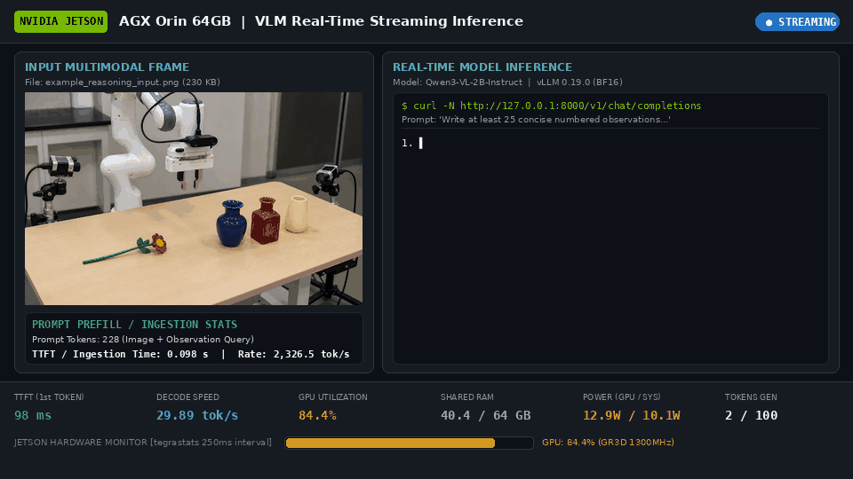
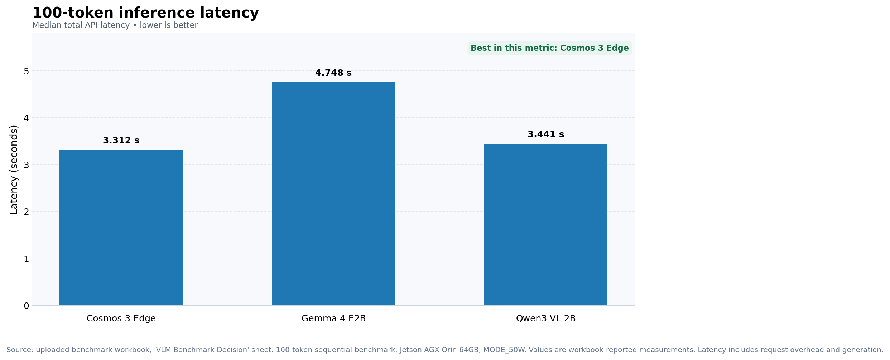
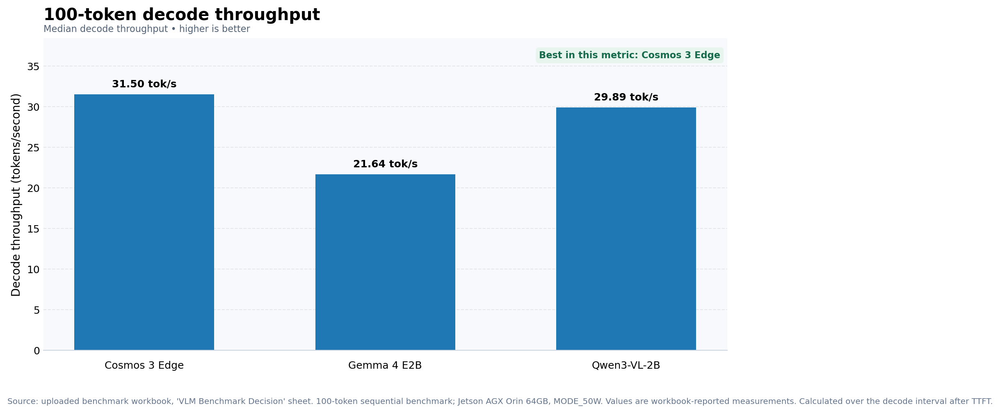
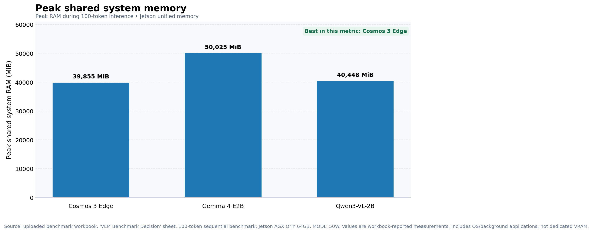
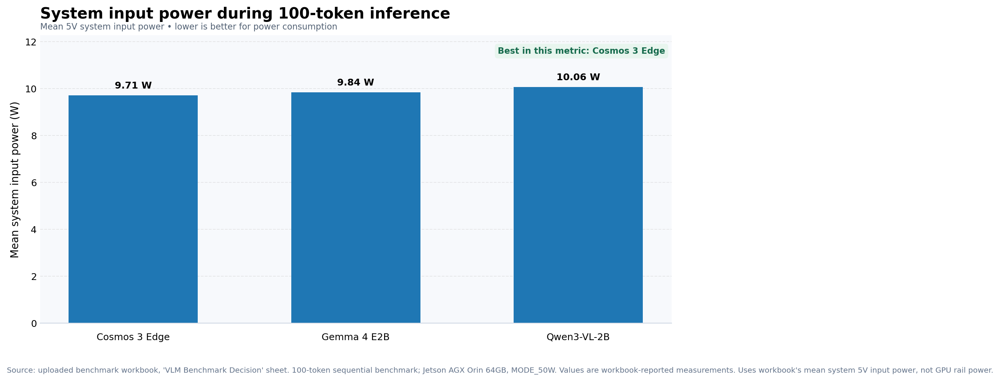

<div align="center">

<h1 align="center">🚀 NVIDIA Jetson AGX Orin — Vision-Language Model (VLM) Benchmark</h1>

[](https://www.nvidia.com/en-us/autonomous-machines/embedded-systems/jetson-orin/)
[](#-hardware--system-specification)
[](#-hardware--system-specification)
[](#-hardware--system-specification)
[](#-evaluated-models--runtimes)
[](#-evaluated-models--runtimes)

**An empirical performance benchmark evaluating real-time Vision-Language Models (VLMs) on the NVIDIA Jetson AGX Orin Developer Kit (64 GB) in 50W power mode.**

[Live Streaming Demo](#-live-streaming-demo-on-jetson-agx-orin) • [Key Findings](#-executive-summary--key-findings) • [Prompting Speed](#-prompting-speed-prefill--ttft-analysis) • [API Speed](#-api-speed--generation-latency-across-token-lengths) • [Visual Charts](#-benchmark-visualizations) • [Reproduction](#-reproduction-guide)

</div>

---

## 📹 Live Streaming Demo on Jetson AGX Orin

Real-time streaming inference running locally on the Jetson AGX Orin with `Qwen3-VL-2B-Instruct` via `vLLM 0.19.0 (BF16)`, processing multimodal input and streaming 100 observation tokens:

<div align="center">
  
</div>

> [!NOTE]
> **Real-World Edge Telemetry**: Ingests the 230 KB visual frame (`example_reasoning_input.png`) and prompt in **0.098 s** (**2,326.5 prompt tokens/sec**), subsequently streaming tokens at **29.89 tokens/sec** (inter-token latency: 33.4 ms) while drawing only **12.9 W** on the GPU rail and utilizing **84.4%** of the Ampere GPU.

---

## ⚡ Executive Summary & Key Findings

| Candidate Model | Exact Loaded Checkpoint | Time-to-First-Token (TTFT) | Prompting Rate | 100-Token Total Latency | Decode Throughput | Shared RAM Peak | Concurrency Behavior | Best Fit |
| :--- | :--- | :---: | :---: | :---: | :---: | :---: | :---: | :--- |
| **Qwen3-VL-2B-Instruct** | `Qwen/Qwen3-VL-2B-Instruct` | **0.098 s** | **2,326 tok/s** | 3.441 s | 29.89 tok/s | 40,448 MiB | Queues all calls (FIFO) | 🥇 **Recommended Edge Baseline** |
| **Cosmos3-Edge reasoning** | `Cosmos3-Edge reasoning` | 0.136 s | — | **3.312 s** | **31.50 tok/s** | **39,855 MiB** | Rejects > batch 1 (503) | 🥈 **Maximum Decode Speed & Low CPU** |
| **Gemma 4 E2B-it** | `google/gemma-4-E2B-it` | 0.128 s | 2,445 tok/s | 4.748 s | 21.64 tok/s | 50,025 MiB | Queues all calls (FIFO) | Gemma Ecosystem Compatibility |
| **Qwen3-VL-4B-Instruct** | `Qwen/Qwen3-VL-4B-Instruct` | 3.913 s | 58.3 tok/s | 14.025 s | 9.88 tok/s | 49,349 MiB | Queues all calls (FIFO) | Requires Domain-Specific Quality Need |

### 🎯 Key Engineering Takeaways:

1. **Qwen3-VL-2B is the Ideal Real-Time Edge Baseline**:
   * **Fastest Prompt Responsiveness**: Reached initial token generation in just **0.098 s** (98 ms).
   * **Near-Engine Throughput**: Achieved **29.89 tok/s** on standard vLLM serving, reaching ~95% the speed of the compiled TensorRT-Edge-LLM engine.
   * **Production-Grade Concurrency**: Successfully queued and serviced all simultaneous API requests without dropping connections.
   * **Webcam Verification**: Processed 29 live webcam frames with an average response time of **2.43 s**.

2. **Cosmos3-Edge Delivers Peak Decode Efficiency**:
   * Led total generation throughput at **31.50 tok/s** with the lowest overall API latency (**3.312 s**).
   * Lowest host CPU overhead (**35.98%**) and lowest shared memory footprint (**39,855 MiB**).
   * *Architecture Note*: Serves requests with strict `max_batch_size=1`; additional concurrent requests return HTTP 503 rather than queueing.

3. **The 2B vs. 4B Scaling Reality on Embedded Hardware**:
   * Upgrading from 2B to 4B parameters resulted in a **3.05× increase in total latency** (4.59 s ➡️ 14.02 s) and reduced decode throughput by **55.6%** (22.28 tok/s ➡️ 9.88 tok/s).
   * Prompt ingestion latency (TTFT) degraded to **3.913 s** on 4B due to unified memory bandwidth limits during large-weight prefill.
   * Average CPU load rose to **84.2%** and GPU utilization pegged at **98.1%**, while testing showed no ground-truth scored accuracy gain.

---

## ⏱️ Prompting Speed (Prefill / TTFT Analysis)

Prompting speed measures the time required by the Vision-Language Model to process the input image (vision encoder pass), ingest the user text query, and generate the very first token (Time-to-First-Token, or TTFT).

| Model | Checkpoint Precision | Input Image | Prompt Tokens | TTFT (Median) | Prompting / Prefill Speed | 1-Token End-to-End Latency |
| :--- | :---: | :---: | :---: | :---: | :---: | :---: |
| **Qwen3-VL-2B-Instruct** | BF16 | 230 KB PNG | 228 tokens | **0.098 s** (98 ms) | **2,326.5 prompt tok/s** | **0.0983 s** |
| **google/gemma-4-E2B-it** | BF16 | 230 KB PNG | 313 tokens | 0.128 s (128 ms) | **2,445.3 prompt tok/s** | 0.1369 s |
| **Cosmos3-Edge reasoning** | FP16 | 230 KB PNG | Multimodal engine | 0.136 s (136 ms) | *Engine Internal* | 0.1450 s |
| **Qwen3-VL-4B-Instruct** | BF16 | 230 KB PNG | 228 tokens | 0.155 s (1 token)<br>3.913 s (100 tokens) | 1,470.9 prompt tok/s<br>58.3 prompt tok/s | 0.1554 s<br>14.025 s |

### Observations on Prompt Ingestion:
* **Sub-100ms Initial Response**: Qwen3-VL-2B crosses the sub-100ms threshold for visual and textual prompt ingestion, making it suitable for low-latency robotic planning and conversational agents.
* **Prefill Bandwidth**: On 2B-class models, prompt ingestion achieves over **2,300 prompt tokens/sec**, verifying that the unified memory bus (204.8 GB/s LPDDR5) comfortably handles vision patch projection and attention prefill for models under ~4 GB.
* **4B Degradation**: When serving the 8.88 GB Qwen 4B checkpoint, prefill latency increases significantly under long token allocations (TTFT spiking to 3.91 s), indicating memory bus saturation.

---

## 📊 API Speed & Generation Latency Across Token Lengths

Sequential token sweeps were executed in triplicate across output token thresholds from 1 to 100 tokens at `temperature=0`:

```
API Request Turnaround Time (Latency in Seconds) vs. Output Token Count
────────────────────────────────────────────────────────────────────────────
Tokens │ Qwen3-VL-2B (vLLM) │ Cosmos3-Edge (TRT) │ Gemma 4 E2B (vLLM) │ Qwen3-VL-4B (vLLM)
───────┼────────────────────┼────────────────────┼────────────────────┼───────────────────
  1    │      0.098 s       │      0.145 s       │      0.137 s       │      0.155 s
 10    │      0.383 s       │         —          │      0.535 s       │      1.083 s
 20    │      0.698 s       │         —          │      0.993 s       │      2.115 s
 30    │      1.011 s       │         —          │      1.638 s       │      3.106 s
 40    │      1.328 s       │         —          │      1.893 s       │      4.106 s
 50    │      1.671 s       │         —          │      2.533 s       │      5.028 s
 60    │      2.065 s       │         —          │      2.859 s       │      9.544 s
 70    │      2.465 s       │         —          │      3.336 s       │     11.025 s
 80    │      2.768 s       │         —          │      3.805 s       │     12.269 s
 90    │      3.108 s       │         —          │      4.411 s       │     13.833 s
100    │      3.441 s       │      3.312 s       │      4.748 s       │     14.025 s
```

### Inter-Token Generation Latency (Decoding Step):
* **Cosmos3-Edge**: **31.7 ms / token** (31.50 tokens/s)
* **Qwen3-VL-2B**: **33.5 ms / token** (29.89 tokens/s)
* **Gemma 4 E2B-it**: **46.2 ms / token** (21.64 tokens/s)
* **Qwen3-VL-4B**: **101.2 ms / token** (9.88 tokens/s)

---

## 📈 Benchmark Visualizations

Comparative charts illustrating performance across models:

### 1. Latency & Response Timing


### 2. Decode Throughput Across Sequence Lengths


### 3. GPU Core Utilization


### 4. Shared System RAM Utilization


### 5. Multi-Rail Power Draw


---

## 🔄 API Concurrency Stress Test

Stress tests submitted concurrent client requests generating 100 tokens each against a single model instance:

| Concurrency Scenario | Metric | Cosmos3-Edge | Gemma 4 E2B-it | Qwen3-VL-2B | Serving Behavior |
| :--- | :--- | :---: | :---: | :---: | :--- |
| **2 Concurrent Requests** | **Accepted / Submitted** | 1 / 2 | **2 / 2** | **2 / 2** | Cosmos rejects with 503; vLLM queues |
| | **Total Wall Time** | 3.307 s | 9.577 s | 7.194 s | Cosmos served 1; vLLM serialized 2 |
| | **Aggregate Throughput** | 30.24 tok/s | 20.88 tok/s | 27.80 tok/s | Sustained tokens/sec |
| **4 Concurrent Requests** | **Accepted / Submitted** | 1 / 4 | **4 / 4** | **4 / 4** | Cosmos rejects with 503; vLLM queues |
| | **Total Wall Time** | 3.325 s | 19.085 s | 13.719 s | vLLM finishes all 4 requests |
| | **Aggregate Throughput** | 30.08 tok/s | 20.96 tok/s | 29.16 tok/s | Sustained tokens/sec |

---

## 📹 Real-Time Live Webcam Evaluation

Tested with a **Logitech Brio 300** USB camera sampling every 30th frame with prompt: *"Describe what you see in this image in one sentence."* (`max_tokens=96`, `temperature=0.7`):

| Metric | Qwen3-VL-2B-Instruct | Qwen3-VL-4B-Instruct | Delta |
| :--- | :---: | :---: | :--- |
| **Successful Frame Responses** | **29** | 12 | 2B completed 2.4× more analyses |
| **API Error Count** | 0 | 0 | 100% request success rate |
| **Mean Full-Response Latency** | **2.427 s** | 4.501 s | **2B is 1.85× faster** |
| **Median Response Latency** | **2.447 s** | 4.422 s | **2B is 1.81× faster** |
| **Mean Host CPU Utilization** | 78.6% | 75.8% | Both handled capture + inference |
| **Peak GPU Utilization** | 99% | 99% | Full GPU activation |
| **Peak Shared System RAM** | 48,474 MiB | 50,183 MiB | Unified memory headroom maintained |
| **Visual Response Consistency** | Consistently identified seated person, office room, plaid shirt, and hand posture | Consistently identified seated person, office room, plaid shirt, and hand posture | Qualitative parity |

---

## 🖥️ Hardware & System Specification

Hardware configuration as reported by `jetson_release`:

```text
Software part of jetson-stats 7.2.0 - (c) 2026, Raffaello Bonghi
Model: NVIDIA Jetson AGX Orin Developer Kit - Jetpack 6.2.1 [L4T 36.4.7]
NV Power Mode[3]: MODE_50W
Hardware:
 - P-Number: p3701-0005
 - Module: NVIDIA Jetson AGX Orin (64GB ram)
Platform:
 - Distribution: Ubuntu 22.04 Jammy Jellyfish
 - Release: 5.15.148-tegra
jtop:
 - Version: 7.2.0
 - Service: Active
Libraries:
 - CUDA: 12.6.68
 - cuDNN: 9.3.0
 - TensorRT: 10.3.0.30
 - VPI: 3.2.4.0
 - Vulkan: 1.3.204
 - OpenCV: 4.10.0 - with CUDA: YES
```

---

## 📁 Repository Structure

```
jetson-agx-orin-vlm-benchmark/
├── README.md                                   # Master benchmark documentation
├── .gitignore                                  # Git exclusion rules reducing repo size to 1.6 MB
├── cosmos_agx_orin_benchmark_2026-11-03.xlsx   # 44-sheet benchmark data and telemetry workbook
├── qwen_3_vlm.py                               # Hugging Face snapshot downloader for Qwen3-VL
│
├── images/                                     # Visual charts and demo media
│   ├── jetson_vlm_streaming_demo.gif           # Real-time streaming inference animation
│   ├── latency_comparison.png                  # TTFT and total latency chart
│   ├── throughput_comparison.png               # Decode throughput chart
│   ├── gpu_utilization.png                     # GPU core utilization chart
│   ├── memory_comparison.png                   # Shared system RAM usage chart
│   └── power_comparison.png                    # Multi-rail power consumption chart
│
├── docs/                                       # Technical methodology documents
│   ├── benchmark_methodology.md                # Sweep methods and telemetry capture procedures
│   ├── hardware_configuration.md               # Hardware specs and software launch parameters
│   ├── model_comparison.md                     # Tabular analysis of Cosmos, Gemma, and Qwen
│   └── deployment_recommendation.md            # Production deployment guidelines
│
├── cosmos3-edge/
│   ├── scripts/
│   │   ├── start_cosmos_server.sh              # TensorRT-Edge-LLM server startup script
│   │   ├── benchmark_vlm_api.py                # Repeatable streaming API benchmark tool
│   │   ├── benchmark_cosmos.py                 # Cosmos-specific streaming benchmark script
│   │   └── cosmos_vlm_compat.py                # Proxy bridging webcam data URLs to engine file paths
│   ├── media/
│   │   ├── example_reasoning_input.png         # Standardized evaluation image (230 KB)
│   │   └── webcam-a0cfdb36a94148508ee8d21edfd081ad.jpg
│   └── results/
│       └── cosmos_agx_orin_benchmark_2026-11-03.xlsx
│
└── patches/                                    # Jetson Orin compatibility patches
    ├── tensorrt-edge-llm-jetson-orin.patch     # Fix for CUDA 12.6 cudaLibraryUnload & CuPy AOT memory
    └── live-vlm-webui-jtop.patch               # Fix for jtop 4+ GenericInterface mapping structure
```

---

## 🛠️ Reproduction Guide

### 1. Apply Jetson Orin Compatibility Patches

```bash
# TensorRT-Edge-LLM CUDA 12.6 / CuPy compatibility patch
cd cosmos3-edge/TensorRT-Edge-LLM
git apply ../../patches/tensorrt-edge-llm-jetson-orin.patch

# live-vlm-webui jtop 4+ GenericInterface compatibility patch
cd ../live-vlm-webui
git apply ../../patches/live-vlm-webui-jtop.patch
```

### 2. Start the Cosmos3-Edge Server

```bash
bash cosmos3-edge/scripts/start_cosmos_server.sh
```

### 3. Launch Qwen3-VL or Gemma with vLLM

```bash
python3 -m vllm.entrypoints.openai.api_server \
  --model ./models/Qwen3-VL-2B-Instruct \
  --dtype bfloat16 \
  --max-model-len 8192 \
  --max-num-seqs 1 \
  --gpu-memory-utilization 0.20 \
  --port 8000
```

### 4. Execute Streaming Benchmark Sweeps

```bash
python3 cosmos3-edge/scripts/benchmark_vlm_api.py \
  --api-url "http://127.0.0.1:8000/v1/chat/completions" \
  --model "Qwen3-VL-2B-Instruct" \
  --image "cosmos3-edge/media/example_reasoning_input.png" \
  --format "openai" \
  --max-tokens 100 \
  --runs 3
```

---

## 📋 44-Sheet Excel Workbook Reference

The master spreadsheet (`cosmos_agx_orin_benchmark_2026-11-03.xlsx`) is structured into the following operational groups:

* **Platform Configuration**: `Configuration`, `Gemma Configuration`, `Qwen Configuration`, `Qwen2B Rerun Configuration`, `Qwen4B Rerun Configuration`.
* **Raw Request Transcripts**: `Requests`, `Gemma Requests`, `Qwen Requests`, `Qwen2B Rerun Requests`, `Qwen4B Rerun Requests`.
* **High-Frequency Telemetry**: `Telemetry Samples`, `Gemma Telemetry`, `Qwen Telemetry`, `Qwen2B Rerun Telemetry`, `Qwen4B Rerun Telemetry`.
* **Token Sweep Summaries**: `Case Summary`, `Gemma Token Sweep`, `Gemma Sweep Summary`, `Qwen Token Sweep`, `Qwen Sweep Summary`, `Qwen2B Rerun Token Sweep`, `Qwen4B Rerun Token Sweep`.
* **Live Webcam Feeds**: `Live Stream Records`, `Live Stream Summary`, `Gemma Live VLM`, `Qwen2B Rerun Live VLM`, `Qwen4B Rerun Live VLM`.
* **Comparative Decision Models**: `Model Comparison`, `VLM Benchmark Decision`, `VLM Recommendation`, `Qwen 2B vs 4B Rerun`, `Qwen 2B vs 4B Recommendation`.

---

## 📌 Production Recommendations

1. **For Real-Time Embedded Robotics**: Deploy **`Qwen3-VL-2B-Instruct`**. It offers fast initial response (**0.098 s TTFT**), ~30 tok/s decode performance, FIFO request queueing, and a modest ~4.2 GiB footprint.
2. **For High-Throughput Batch-1 Serving**: Deploy **`Cosmos3-Edge reasoning`**. It provides the highest generation throughput (**31.5 tok/s**) and lowest CPU footprint (**36%**).
3. **Scaling Constraints**: Avoid moving to 4B+ parameter models on embedded edge devices unless application-specific evaluation demonstrates a notable accuracy improvement that justifies the 3× latency increase.

---

## 📄 License & Attribution

- Benchmarked on NVIDIA Jetson AGX Orin Developer Kit.
- Built using NVIDIA JetPack, TensorRT-Edge-LLM, vLLM, and Hugging Face Transformers.
- Workbook and data records: © 2026 Algosium / Vivek Joy.
