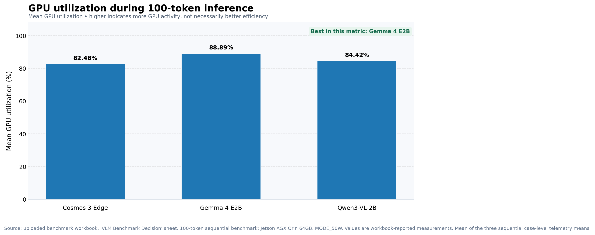

# NVIDIA Jetson AGX Orin — Vision-Language Model (VLM) Benchmark

[](https://www.nvidia.com/en-us/autonomous-machines/embedded-systems/jetson-orin/)
[](#hardware--system-specification)
[](#software-stack)
[](#software-stack)
[](#model-runtimes--configurations)
[](#model-runtimes--configurations)

A comprehensive empirical evaluation and benchmarking suite of modern Vision-Language Models (VLMs) running locally on the **NVIDIA Jetson AGX Orin Developer Kit (64 GB)** in `MODE_50W`. 

This benchmark evaluates inference latency (Time-to-First-Token and total generation time), decoding throughput, API concurrency behavior, power draw across individual hardware rails, shared system memory utilization, and real-time live webcam streaming.

---

## Table of Contents

- [Executive Summary & Key Findings](#executive-summary--key-findings)
- [Benchmark Visualizations](#benchmark-visualizations)
- [Evaluated Models & Runtimes](#evaluated-models--runtimes)
- [Comprehensive Benchmark Results](#comprehensive-benchmark-results)
  - [1. Main Fixed-Image Comparison (100 Tokens)](#1-main-fixed-image-comparison-100-tokens)
  - [2. API Concurrency Stress Test](#2-api-concurrency-stress-test)
  - [3. Dedicated Qwen 2B vs. 4B Rerun](#3-dedicated-qwen-2b-vs-4b-rerun)
  - [4. Real-Time Live Webcam Evaluation](#4-real-time-live-webcam-evaluation)
- [Hardware & Software Stack](#hardware--software-stack)
- [Repository Structure](#repository-structure)
- [Benchmark Methodology & Protocol](#benchmark-methodology--protocol)
- [Excel Workbook Analysis (44 Sheets)](#excel-workbook-analysis-44-sheets)
- [Reproduction Guide](#reproduction-guide)
  - [1. Environment & Jetson Orin Patches](#1-environment--jetson-orin-patches)
  - [2. Serving Cosmos3-Edge with TensorRT-Edge-LLM](#2-serving-cosmos3-edge-with-tensorrt-edge-llm)
  - [3. Serving Qwen3-VL and Gemma with vLLM](#3-serving-qwen3-vl-and-gemma-with-vllm)
  - [4. Running Automated Benchmarks](#4-running-automated-benchmarks)
  - [5. Running the Live Webcam Proxy](#5-running-the-live-webcam-proxy)
- [Deployment Recommendations](#deployment-recommendations)
- [License & Acknowledgments](#license--acknowledgments)

---

## Executive Summary & Key Findings

| Candidate | Time-to-First-Token (TTFT) | 100-Token Latency | Decode Throughput | Shared RAM Peak | Concurrency Behavior | Best Fit |
| :--- | :---: | :---: | :---: | :---: | :---: | :--- |
| **Qwen3-VL-2B-Instruct** | **0.098 s** | 3.441 s | 29.89 tok/s | 40,448 MiB | Queues all calls | **Recommended edge baseline** |
| **Cosmos3-Edge reasoning** | 0.136 s | **3.312 s** | **31.50 tok/s** | **39,855 MiB** | Rejects > batch 1 (503) | Maximum decode speed & low CPU |
| **google/gemma-4-E2B-it** | 0.128 s | 4.748 s | 21.64 tok/s | 50,025 MiB | Queues all calls | Gemma ecosystem compatibility |
| **Qwen3-VL-4B-Instruct** | 3.913 s | 14.025 s | 9.88 tok/s | 49,349 MiB | Queues all calls | Requires quality justification |

### Core Takeaways:

1. **Qwen3-VL-2B is the Recommended Real-Time Edge Baseline**:
   - Fastest prompt ingestion / Time-To-First-Token (**0.098 s** median).
   - High decode throughput (**29.89 tok/s**), reaching ~95% of Cosmos3-Edge speed while using standard vLLM serving.
   - Handled all concurrent requests seamlessly via request queueing.
   - Processed 29 real-time webcam descriptions with mean latency of **2.43 s**.

2. **Cosmos3-Edge Delivers Top Decode Speed with Low CPU Overhead**:
   - Fastest 100-token decode throughput at **31.50 tok/s** and lowest total latency at **3.312 s**.
   - Lowest mean CPU utilization (**35.98%**) and lowest peak system RAM footprint (**39,855 MiB**).
   - *Operational constraint*: Configured with `max_batch_size=1`, rejecting incoming requests above capacity with HTTP 503 instead of queueing.

3. **2B vs. 4B Scaling Shows Severe Edge Penalties**:
   - In the controlled Qwen rerun, increasing parameter size from 2B to 4B resulted in a **3.05× latency increase** at 100 tokens (4.59 s vs. 14.025 s) and cut decode speed by **55.6%** (22.28 tok/s down to 9.88 tok/s).
   - TTFT for 4B jumped to **3.913 s** (vs. 0.102 s for 2B).
   - CPU utilization surged from 62.9% to 84.2%, and GPU utilization reached 98.1%.
   - In benchmark testing, 4B demonstrated no verified accuracy advantage justifying its latency and resource overhead.

4. **Unified Memory & Power Characteristics**:
   - Jetson AGX Orin utilizes a unified memory architecture (64 GB shared between CPU, GPU, OS, and background processes).
   - Model memory consumption remained within thermal bounds in `MODE_50W`, with mean GPU rail power between 11.66 W and 13.22 W, and total system input power below 10.2 W.

---

## Benchmark Visualizations

The generated performance charts offer comparative insight into latency, throughput, utilization, memory, and power:

### 1. Latency Comparison


### 2. Throughput Comparison


### 3. GPU Utilization Profile


### 4. Memory Footprint (Shared System RAM)


### 5. Multi-Rail Power Draw


---

## Evaluated Models & Runtimes

| Model | Exact Loaded Checkpoint | Runtime Engine | Precision | Context Length | Engine / Checkpoint Size | Serving Architecture |
| :--- | :--- | :--- | :---: | :---: | :---: | :--- |
| **Cosmos3-Edge** | `Cosmos3-Edge reasoning` | TensorRT-Edge-LLM 0.10.0 | FP16 | 4096 (KV cache) | 3.14 GiB (LLM) + 0.92 GiB (Visual) | C++ Native + Python Server |
| **Qwen3-VL-2B** | `Qwen/Qwen3-VL-2B-Instruct` | vLLM 0.19.0 | BF16 | 8192 | 4.26 GB (4.24 GiB load RAM) | OpenAI-compatible REST API |
| **Qwen3-VL-4B** | `Qwen/Qwen3-VL-4B-Instruct` | vLLM 0.19.0 | BF16 | 8192 | 8.88 GB (8.59 GiB load RAM) | OpenAI-compatible REST API |
| **Gemma 4 E2B** | `google/gemma-4-E2B-it` | vLLM 0.19.0 | BF16 | 8192 | ~9.79 GiB load RAM | Docker (`gemma4-e2b`) |

> **Naming Note:** The tested Gemma checkpoint is explicitly `google/gemma-4-E2B-it` (effective 2B-class architecture), not a 4B checkpoint.

---

## Comprehensive Benchmark Results

### 1. Main Fixed-Image Comparison (100 Tokens)

Measured using `example_reasoning_input.png` and a standardized 25-item observation prompt at `temperature=0`:

| Metric | Cosmos3-Edge reasoning | Gemma 4 E2B-it | Qwen3-VL-2B-Instruct | Leading Model |
| :--- | :---: | :---: | :---: | :---: |
| **Serving Runtime** | TensorRT-Edge-LLM 0.10.0 | vLLM 0.19.0 | vLLM 0.19.0 | — |
| **1-Token Median Latency** | 0.145 s | 0.131 s | **0.098 s** | **Qwen3-VL-2B** |
| **1-Token Median TTFT** | 0.143 s | 0.131 s | **0.098 s** | **Qwen3-VL-2B** |
| **100-Token Median Latency** | **3.312 s** | 4.748 s | 3.441 s | **Cosmos3-Edge** |
| **100-Token Median TTFT** | 0.136 s | 0.128 s | **0.097 s** | **Qwen3-VL-2B** |
| **100-Token Decode Throughput** | **31.50 tok/s** | 21.64 tok/s | 29.89 tok/s | **Cosmos3-Edge** |
| **Mean CPU Utilization** | **35.98%** | 52.62% | 52.61% | **Cosmos3-Edge** |
| **Peak CPU Core Utilization** | 100% | 100% | 100% | Tie |
| **Mean GPU Utilization** | 82.48% | 88.89% | 84.42% | — |
| **Peak GPU Utilization** | 99% | 99% | 99% | Tie |
| **Peak Shared System RAM** | **39,855 MiB** | 50,025 MiB | 40,448 MiB | **Cosmos3-Edge** |
| **Mean GPU Rail Power** | **12.68 W** | 12.70 W | 12.94 W | **Cosmos3-Edge** |
| **Mean CPU/CV Rail Power** | **2.57 W** | 3.33 W | 3.38 W | **Cosmos3-Edge** |
| **Mean 5V System Input Power** | **9.71 W** | 9.84 W | 10.06 W | **Cosmos3-Edge** |

---

### 2. API Concurrency Stress Test

Submitting simultaneous requests (each generating 100 tokens) to a single model instance:

| Concurrency Scenario | Metric | Cosmos3-Edge | Gemma 4 E2B-it | Qwen3-VL-2B | Serving Mechanism |
| :--- | :--- | :---: | :---: | :---: | :--- |
| **2 Concurrent Requests** | **Accepted / Submitted** | 1 / 2 | **2 / 2** | **2 / 2** | Cosmos rejects excess (503); vLLM queues |
| | **Wall Time** | 3.307 s | 9.577 s | 7.194 s | Cosmos served 1 request; vLLM serialized 2 |
| | **Aggregate Throughput** | 30.24 tok/s | 20.88 tok/s | 27.80 tok/s | Sustained tokens/s |
| **4 Concurrent Requests** | **Accepted / Submitted** | 1 / 4 | **4 / 4** | **4 / 4** | Cosmos rejects excess (503); vLLM queues |
| | **Wall Time** | 3.325 s | 19.085 s | 13.719 s | vLLM completes all 4 queued requests |
| | **Aggregate Throughput** | 30.08 tok/s | 20.96 tok/s | 29.16 tok/s | Sustained tokens/s |

---

### 3. Dedicated Qwen 2B vs. 4B Rerun

Direct head-to-head rerun of `Qwen3-VL-2B-Instruct` and `Qwen3-VL-4B-Instruct` under identical parameters (`vLLM 0.19.0`, `BF16`, `max_model_len=8192`, `max_num_seqs=1`, `MODE_50W`):

| Benchmark Dimension | Qwen3-VL-2B-Instruct | Qwen3-VL-4B-Instruct | Delta / Analysis |
| :--- | :---: | :---: | :--- |
| **Weight Size on Disk** | 4.26 GB | 8.88 GB | +108.5% storage requirement |
| **vLLM Load Memory** | 4.24 GiB | 8.59 GiB | +102.6% GPU RAM allocation |
| **Token Sweep (1 to 100)** | 33 / 33 passed | 33 / 33 passed | 100% test reliability |
| **1-Token Median Latency** | **0.110 s** | 0.155 s | 2B is 29% faster |
| **100-Token Median Total Latency** | **4.590 s** | 14.025 s | **2B is 3.05× faster** |
| **100-Token Median TTFT** | **0.102 s** | 3.913 s | **4B TTFT is 38.4× higher** |
| **100-Token Decode Throughput** | **22.28 tok/s** | 9.88 tok/s | **2B decode is 2.25× faster** |
| **Mean CPU Utilization** | **62.9%** | 84.2% | 4B heavily strains CPU cores |
| **Mean GPU Utilization** | 92.2% | 98.1% | 4B approaches GPU saturation |
| **Peak Shared System RAM** | **47,842 MiB** | 49,349 MiB | +1,507 MiB memory consumption |
| **Mean GPU Rail Power** | **11.66 W** | 13.22 W | 4B draws +13.4% GPU power |
| **Mean CPU/CV Rail Power** | **3.94 W** | 4.97 W | 4B draws +26.1% CPU power |
| **2 Concurrent Requests Wall Time** | **9.06 s** | 24.11 s | 4B queue wait 2.66× longer |
| **4 Concurrent Requests Wall Time** | **18.16 s** | 42.07 s | 4B queue wait 2.32× longer |

---

### 4. Real-Time Live Webcam Evaluation

Tested with a **Logitech Brio 300** USB camera sampling every 30th frame with prompt: *"Describe what you see in this image in one sentence."* (`max_tokens=96`, `temperature=0.7`):

| Live Metric | Qwen3-VL-2B-Instruct | Qwen3-VL-4B-Instruct |
| :--- | :---: | :---: |
| **Captured Frame Responses** | **29 successful** | 12 successful |
| **Failed API Calls** | 0 | 0 |
| **Mean Full-Response Latency** | **2.427 s** | 4.501 s |
| **Median Full-Response Latency** | **2.447 s** | 4.422 s |
| **Total Prompt / Completion Tokens** | 17,969 / 1,126 | 6,112 / 433 |
| **Mean CPU Utilization** | 78.6% | 75.8% |
| **Peak GPU Utilization** | 99% | 99% |
| **Peak Shared System RAM** | 48,474 MiB | 50,183 MiB |
| **Qualitative Consistency** | Consistently identified seated person, office setting, plaid shirt, and posture | Consistently identified seated person, office setting, plaid shirt, and posture |

---

## Hardware & Software Stack

### Target Hardware Platform
- **Device**: NVIDIA Jetson AGX Orin Developer Kit
- **Module RAM**: 64 GB 256-bit LPDDR5 (204.8 GB/s unified bandwidth)
- **Power Configuration**: `MODE_50W` (configured via `nvpmodel -m 0`)
- **CPU**: 12-core ARM Cortex-A78AE v8.2 64-bit CPU
- **GPU**: 2048-core NVIDIA Ampere architecture with 64 Tensor Cores
- **Camera**: Logitech Brio 300 Full HD Webcam

### Software & Toolchain
- **OS**: Ubuntu 22.04.5 LTS (Jammy Jellyfish)
- **Kernel**: `5.15.148-tegra` (aarch64)
- **NVIDIA JetPack**: 6.2.1
- **L4T**: 36.4.7
- **CUDA**: 12.6.68
- **cuDNN**: 9.3.0
- **TensorRT**: 10.3.0.30
- **VPI**: 3.2.4.0
- **System Telemetry**: `jetson-stats` (jtop 7.2.0) and `tegrastats`

---

## Repository Structure

```
jetson-agx-orin-vlm-benchmark/
├── README.md                                   # Comprehensive benchmark report and documentation
├── .gitignore                                  # Git exclusion rules reducing repo size from 37GB to 1.6MB
├── cosmos_agx_orin_benchmark_2026-11-03.xlsx   # Complete 44-sheet benchmark data and telemetry workbook
├── qwen_3_vlm.py                               # Hugging Face snapshot download utility for Qwen3-VL
├── latency_comparison.png                      # Visualization: TTFT & end-to-end latency
├── throughput_comparison.png                   # Visualization: Decode throughput across output lengths
├── gpu_utilization.png                         # Visualization: GPU core utilization comparison
├── memory_comparison.png                       # Visualization: Shared system RAM allocation
├── power_comparison.png                        # Visualization: Multi-rail power consumption
│
├── docs/                                       # Detailed technical documentation and deep dives
│   ├── benchmark_methodology.md                # Protocols, sweep methods, and telemetry capture procedures
│   ├── hardware_configuration.md               # Hardware specs, software versions, and launch flags
│   ├── model_comparison.md                     # Tabular analysis of Cosmos, Gemma, and Qwen runs
│   └── deployment_recommendation.md            # Production deployment guidelines and next steps
│
├── cosmos3-edge/
│   ├── scripts/
│   │   ├── start_cosmos_server.sh              # TensorRT-Edge-LLM server startup script
│   │   ├── benchmark_vlm_api.py                # Repeatable streaming API benchmark tool
│   │   ├── benchmark_cosmos.py                 # Cosmos-specific streaming benchmark script
│   │   └── cosmos_vlm_compat.py                # Compatibility bridge: Live VLM data URL -> file path
│   ├── media/
│   │   ├── example_reasoning_input.png         # Standardized evaluation image (230 KB)
│   │   └── webcam-a0cfdb36a94148508ee8d21edfd081ad.jpg # Captured sample frame
│   └── results/
│       └── cosmos_agx_orin_benchmark_2026-11-03.xlsx
│
└── patches/                                    # Jetson Orin compatibility patches for upstream code
    ├── tensorrt-edge-llm-jetson-orin.patch     # Fix for CUDA 12.6 cudaLibraryUnload & CuPy AOT memory
    └── live-vlm-webui-jtop.patch               # Fix for jtop 4+ GenericInterface mapping structure
```

---

## Benchmark Methodology & Protocol

### 1. Fixed Input Image & Prompt
- **Image**: `cosmos3-edge/media/example_reasoning_input.png` (230,656 bytes).
- **Prompt**:
  > *"Write at least 25 concise numbered observations about this image. Include visible objects, colors, their positions, background, lighting, and likely setting. Continue enumerating. Do not add an introduction or conclusion."*
- **Parameters**: `temperature=0`, `stream=True`, `stream_options.include_usage=True`.

### 2. Sequential Token Sweep
1. The target model server was started; all other model containers were stopped.
2. An initial unmeasured warm-up request was executed to prime the KV cache and GPU kernels.
3. Three measured repetitions were executed at each output token threshold: 1, 10, 20, ..., 100 tokens.
4. Telemetry was sampled synchronously via `tegrastats` at 100 ms – 250 ms intervals.

### 3. Concurrency Protocol
- Submitted 2 and 4 simultaneous client requests (`max_tokens=100`) against a single server instance.
- Verified response status (HTTP 200 vs 503) and recorded serialized wall clock time and aggregate decode rate.

---

## Excel Workbook Analysis (44 Sheets)

The included `cosmos_agx_orin_benchmark_2026-11-03.xlsx` workbook serves as the primary source of truth:

1. **Configuration & Specs**: `Configuration`, `Gemma Configuration`, `Qwen Configuration`, `Qwen2B Rerun Configuration`, `Qwen4B Rerun Configuration`.
2. **Raw Request Logs**: `Requests`, `Gemma Requests`, `Qwen Requests`, `Qwen2B Rerun Requests`, `Qwen4B Rerun Requests`.
3. **Telemetry Logs**: `Telemetry Samples`, `Gemma Telemetry`, `Qwen Telemetry`, `Qwen2B Rerun Telemetry`, `Qwen4B Rerun Telemetry`.
4. **Token Sweeps & Summaries**: `Case Summary`, `Gemma Token Sweep`, `Gemma Sweep Summary`, `Qwen Token Sweep`, `Qwen Sweep Summary`, `Qwen2B Rerun Token Sweep`, `Qwen4B Rerun Token Sweep`.
5. **Live Webcam Logs**: `Live Stream Records`, `Live Stream Summary`, `Gemma Live VLM`, `Qwen2B Rerun Live VLM`, `Qwen4B Rerun Live VLM`.
6. **Decision & Recommendation Sheets**: `Model Comparison`, `VLM Benchmark Decision`, `VLM Recommendation`, `Qwen 2B vs 4B Rerun`, `Qwen 2B vs 4B Recommendation`.

---

## Reproduction Guide

### 1. Environment & Jetson Orin Patches

If compiling `TensorRT-Edge-LLM` or running `live-vlm-webui` on JetPack 6.2.1 / CUDA 12.6, apply the provided patches:

```bash
# Apply patch to TensorRT-Edge-LLM
cd cosmos3-edge/TensorRT-Edge-LLM
git apply ../../patches/tensorrt-edge-llm-jetson-orin.patch

# Apply patch to live-vlm-webui
cd ../live-vlm-webui
git apply ../../patches/live-vlm-webui-jtop.patch
```

### 2. Serving Cosmos3-Edge with TensorRT-Edge-LLM

Start the local Cosmos server:

```bash
bash cosmos3-edge/scripts/start_cosmos_server.sh
```

### 3. Serving Qwen3-VL and Gemma with vLLM

Run vLLM with the benchmarked settings (`BF16`, 8192 context, `max_num_seqs=1`):

```bash
python3 -m vllm.entrypoints.openai.api_server \
  --model ./models/Qwen3-VL-2B-Instruct \
  --dtype bfloat16 \
  --max-model-len 8192 \
  --max-num-seqs 1 \
  --gpu-memory-utilization 0.20 \
  --port 8000
```

### 4. Running Automated Benchmarks

Execute the streaming benchmark suite:

```bash
python3 cosmos3-edge/scripts/benchmark_vlm_api.py \
  --api-url "http://127.0.0.1:8000/v1/chat/completions" \
  --model "Qwen3-VL-2B-Instruct" \
  --image "cosmos3-edge/media/example_reasoning_input.png" \
  --format "openai" \
  --max-tokens 100 \
  --runs 3
```

### 5. Running the Live Webcam Proxy

When running with web frontends sending base64 data URLs:

```bash
python3 cosmos3-edge/scripts/cosmos_vlm_compat.py
```

---

## Deployment Recommendations

1. **For Real-Time Embedded Vision**: Choose **Qwen3-VL-2B-Instruct**. It provides fast prompt responsiveness (**0.098 s TTFT**), ~30 tok/s decode speed, reliable request queuing, and a modest ~4.2 GiB memory footprint.
2. **For High-Throughput Edge Reasoning**: Choose **Cosmos3-Edge**. It delivers the highest generation speed (**31.5 tok/s**) and lowest CPU footprint (**36%**), provided the client pipeline accommodates single-batch serving.
3. **Model Scaling**: Avoid deploying **Qwen3-VL-4B** in real-time edge pipelines without verifying whether its higher latency (~14 s for 100 tokens) is offset by domain-specific visual accuracy gains.
4. **Production Considerations**: Validate end-to-end latency (including camera grab, encode/transport, and inference) under sustained thermal loads on the Orin platform.

---

## License & Acknowledgments

- Benchmarks conducted on NVIDIA Jetson AGX Orin Developer Kit.
- Built using NVIDIA JetPack, TensorRT-Edge-LLM, vLLM, and Hugging Face Transformers.
- Workbook and data records: © 2026 Algosium / Vivek Joy.
